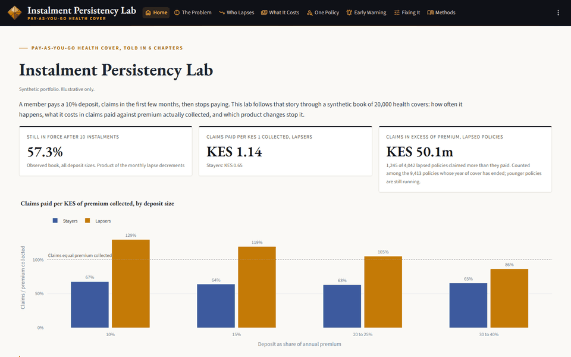
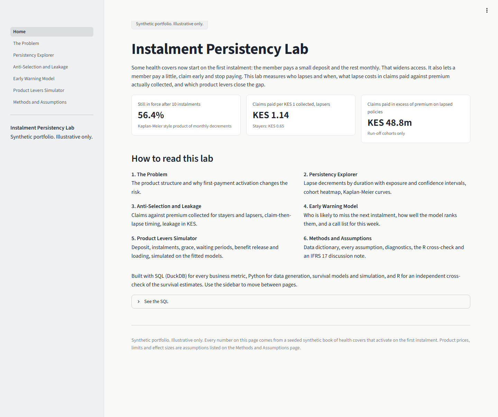
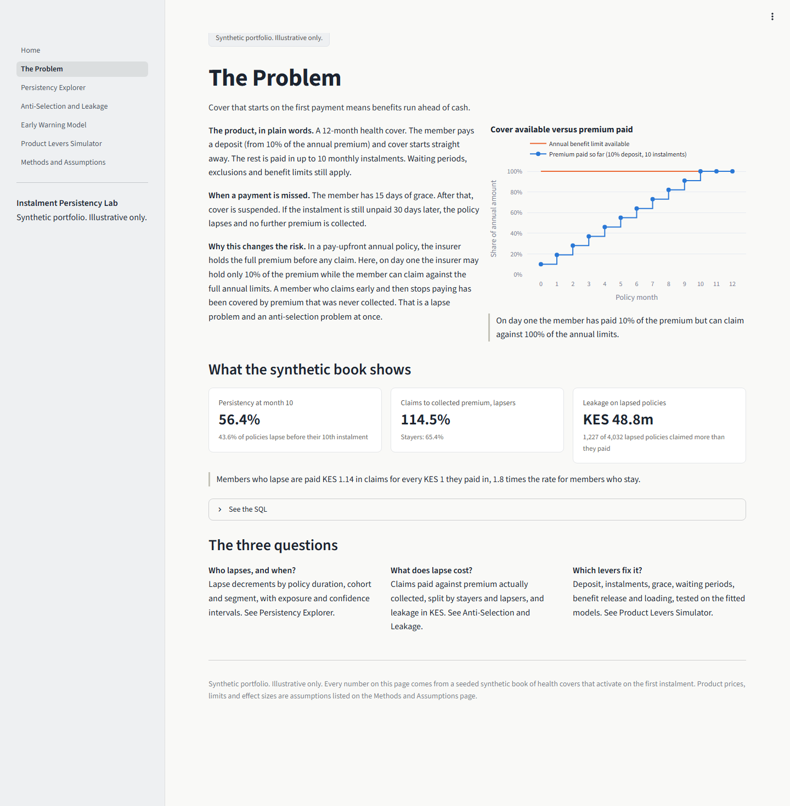
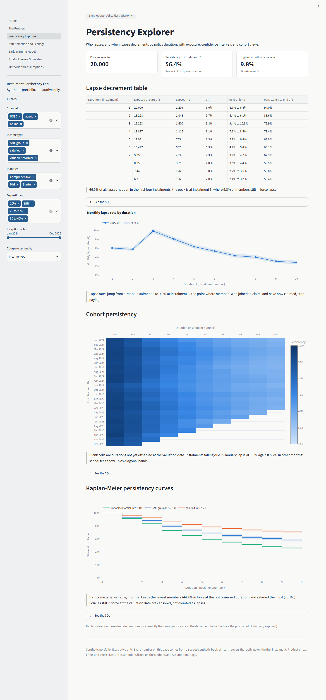
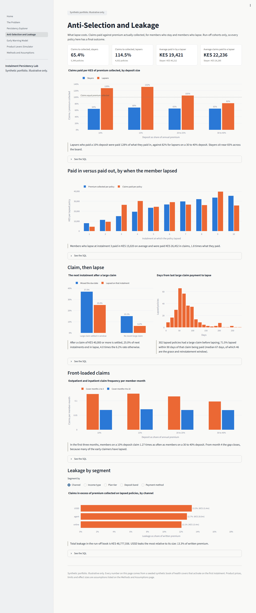
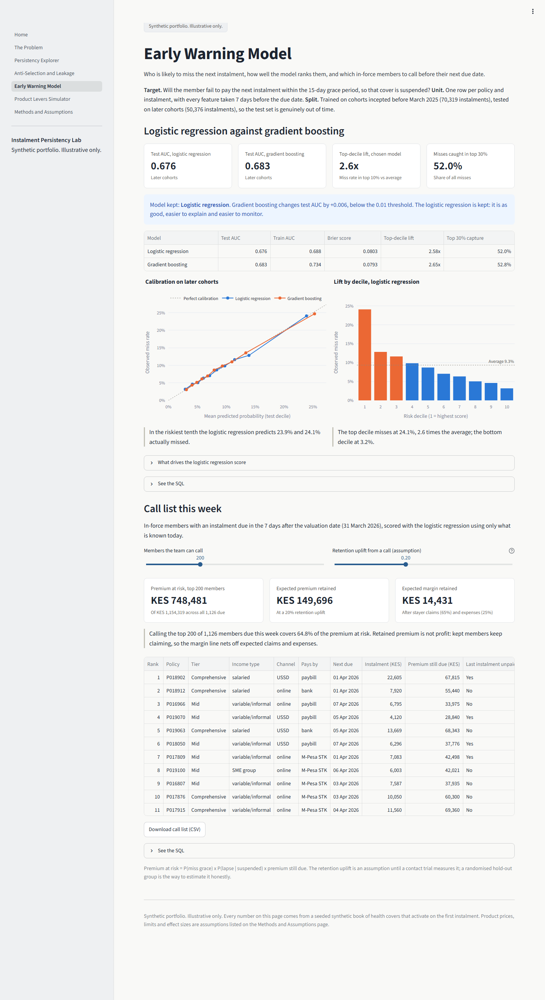
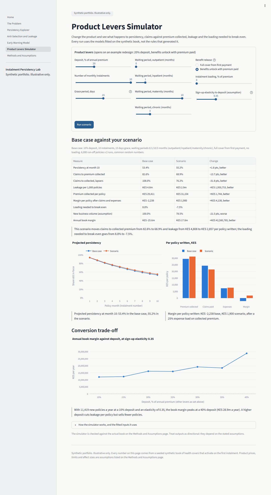
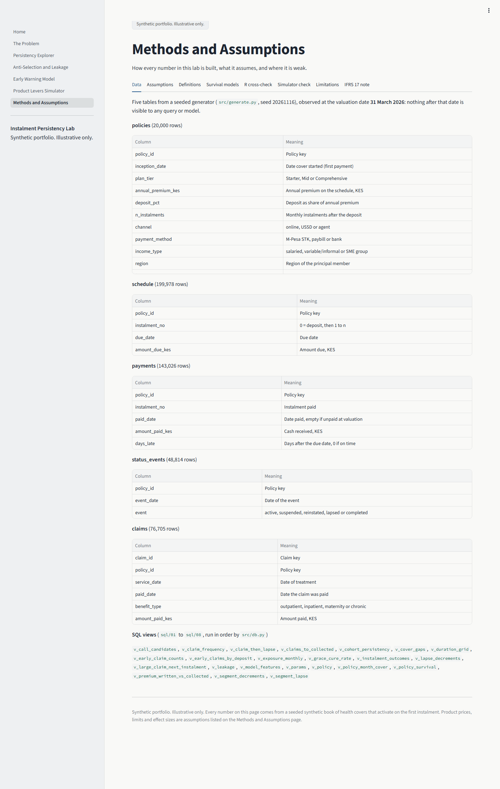

# Instalment Persistency Lab

Some health covers now start on the first instalment: the member pays a small deposit and the rest monthly. That widens access, but it lets a member pay a little, claim early and stop paying, so the insurer pays claims against premium it never collects. This lab measures who lapses and when, what lapse costs, and which product levers close the gap, on a seeded synthetic book of 20,000 policies. In that book, 56.4% of policies are still in force after their 10th instalment. Members who lapse are paid KES 1.14 in claims for every KES 1 they paid in, against KES 0.65 for members who stay. Claims in excess of premium collected on lapsed policies come to KES 48.8m. At a 10% deposit with full cover from day one, the product needs a loading of about 9% to break even after expenses. In the simulator, releasing benefits in line with premium paid plus a three-month inpatient waiting period more than closes that gap.

**Live app:** `https://<your-app>.streamlit.app` (free apps sleep when idle; the screenshots below show every page)

> Synthetic portfolio. Illustrative only. No real customer data, no insurer's results.

## Screenshots



| | |
|---|---|
|  |  |
|  |  |
|  |  |
|  | |

## Context

Kenyan health covers that start on a first instalment, with the rest paid over up to 10 months, are now on sale. Waiting periods, exclusions and benefit limits still apply. Public coverage of that structure:

- Jubilee Health expands Lipa Pole Pole, [HapaKenya](https://hapakenya.com/2026/07/06/jubilee-health-expands-lipa-pole-pole-allowing-customers-to-pay-in-10-instalments/), 6 July 2026
- Lipa Pole Pole structure and 10% starting payment, [Kenyans.co.ke](https://www.kenyans.co.ke/featured/126296-jubilees-lipa-pole-pole-how-health-cover-can-start-ksh110-day)
- Waiting periods and terms still apply, [Kenyans.co.ke](https://www.kenyans.co.ke/featured/126911-jubilee-lipa-pole-pole-how-pay-health-insurance-easy-monthly-instalments)
- Kenya medical insurance loss ratio context, [Sharp Daily](https://thesharpdaily.com/?p=37998)

**Disclaimer.** Every number in the app comes from a synthetic book generated by `src/generate.py` from the assumptions in `src/config.yaml`. Prices, limits and effect sizes are illustrative parameters, not quotes, and nothing here describes any insurer's lapse rates, loss ratios or results. The app describes the product structure generically and uses no insurer's name, logo or colours.

## Method

| Layer | What it does | Where |
|---|---|---|
| Data | 20,000 policies over 24 inception months, with schedules, payments, status events and claims, observed at 31 March 2026. Missed-payment hazard depends on income type, channel, payment method, affordability, age, prior late payments and calendar months. Lapse follows a grace and reinstatement rule. A buy-to-claim share, larger at low deposits, front-loads claims and stops paying. Large claims raise the hazard of missing the next instalment. | `src/generate.py`, `src/config.yaml` |
| SQL | Every business metric is a DuckDB view: policy-month exposure, crude decrements with Wilson intervals, cohort persistency, premium written against collected, grace cure rates, claims to collected for stayers and lapsers, claim-then-lapse timing, leakage, segment decrements, covered-time claim frequency and model features. Each headline number in the app has a "See the SQL" expander. | `sql/01` to `sql/08` |
| Decrements | Monthly lapse rates by duration with exposure and 95% CIs, set out as a decrement table. Exposure is censored at the valuation date, not treated as survival. | Persistency Explorer |
| Survival | Kaplan-Meier persistency by segment (identical to the decrement table on whole-month durations). Cox proportional hazards with hazard ratios and CIs; the proportional hazards check fails for number of instalments and deposit size, and the Methods page says why. | `src/models.py` |
| Early warning | Person-period classifier for "misses the next instalment beyond grace", features taken 7 days before each due date, trained on earlier cohorts and tested on later ones. Gradient boosting adds less than 0.01 AUC over logistic regression, so the logistic regression is kept. Calibration, lift by decile and a weekly call list. | Early Warning Model |
| Simulation | Monte Carlo on the fitted models: discrete-time miss hazard, a mixture cure model for time to pay, observed claim frequency per covered exposure unit with a deposit-linked anti-selection relativity and gamma frailty, and resampled claim sizes. Levers: deposit, instalments, grace, waiting periods, benefit release rule, loading and sign-up elasticity. Back-tested against the actual book; it understates leakage, which the app says plainly. | `src/simulate.py` |
| R cross-check | `r/km_cox_check.R` refits Kaplan-Meier and Cox in R's `survival` package from the same exported data. Python and R agree to 1e-15 on Kaplan-Meier and 2e-6 on Cox coefficients (both Efron ties); Breslow is shown for comparison. | `r/`, Methods page |

Tests (`tests/`) check row counts, no negative amounts, date consistency, the lapse rule, waiting periods, exposure reconciliation to policy counts, rates within 0 and 1, and that collected premium never exceeds written premium.

## What I would do with real data

- **Data needed.** Policy and member records, the full instalment schedule, every payment attempt (including failed M-Pesa prompts), status changes with reasons, and paid and outstanding claims with diagnosis and provider. Ideally declared income band and the sales agent.
- **Validation.** Reconcile exposure and premium to the finance ledger first. Test each assumption in `config.yaml` against the data instead of assuming it: does the deposit effect exist, how strong is the post-claim lapse, what does the cure curve look like. Fit the early warning model with a strict out-of-time split and monitor calibration monthly.
- **Measure, do not assume, the retention uplift.** Run the call list as a randomised trial with a hold-out group.
- **Governance.** Document model purpose and limits, keep a model inventory entry, review fairness across region and income type, and agree the IFRS 17 treatment of expected lapses and uncollected instalments with finance and the auditor.

## How to run locally

```bash
python -m venv .venv
.venv/Scripts/python -m pip install -r requirements.txt   # macOS or Linux: .venv/bin/python
.venv/Scripts/python -m pytest
.venv/Scripts/python -m streamlit run app.py
```

The parquet files in `data/` are generated by `python -m src.generate` (seeded, so identical every time) and the DuckDB database is built in memory at app start. To refresh the R cross-check:

```bash
python -m src.models export
Rscript r/km_cox_check.R
```

Built and tested with Python 3.12 and R 4.5.1 (`survival` 3.8.3). On Streamlit Community Cloud, choose Python 3.12 under Advanced settings.

## Why I built this

_Placeholder for Marion to write in her own voice._
