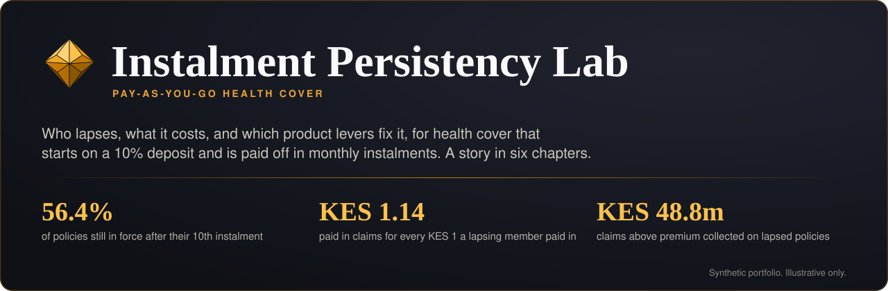

<p align="center">
  <a href="https://instalment-persistency-lab.streamlit.app/">
    
  </a>
</p>

<p align="center">
  <a href="https://instalment-persistency-lab.streamlit.app/"></a>
  
  
  
  
</p>

<p align="center">
  <a href="#the-question">The question</a> &nbsp;|&nbsp;
  <a href="#a-quick-tour">A quick tour</a> &nbsp;|&nbsp;
  <a href="#context">Context</a> &nbsp;|&nbsp;
  <a href="#method">Method</a> &nbsp;|&nbsp;
  <a href="#what-i-would-do-with-real-data">With real data</a> &nbsp;|&nbsp;
  <a href="#run-it-locally">Run it locally</a> &nbsp;|&nbsp;
  <a href="#why-i-built-this">Why I built this</a>
</p>

<p align="center"></p>

## The question

Some health covers in Kenya now start on the first instalment. The member pays a small deposit, from 10% of the annual premium, and the rest over up to 10 months. That widens access to cover. It also lets a member pay a little, claim early and stop paying, so the insurer pays claims against premium it never collects.

This lab asks three things of a seeded synthetic book of 20,000 policies:

| | Question | What the synthetic book says |
|:---:|---|---|
| **1** | **Who lapses, and when?** | 56.4% of policies are still in force after their 10th instalment. Lapse peaks at instalment 3, at 9.8% a month, and two thirds of all lapses happen in the first four instalments. |
| **2** | **What does lapse cost?** | Members who lapse are paid KES 1.14 in claims for every KES 1 they paid in, against KES 0.65 for members who stay. Claims above premium collected on lapsed policies come to KES 48.8m. |
| **3** | **Which levers fix it?** | At a 10% deposit with full cover from day one, the product needs a loading of about 9% to break even after expenses. Releasing benefits in line with premium paid, with a 20% deposit, turns that into a margin in the simulator. |

> [!IMPORTANT]
> **Synthetic portfolio. Illustrative only.** Every number comes from a book generated by `src/generate.py` from the assumptions in `src/config.yaml`. Prices, limits and effect sizes are illustrative parameters, not quotes. Nothing here describes any insurer's lapse rates, loss ratios or results, and the app uses no insurer's name, logo or colours.

<p align="center"></p>

## A quick tour

> [!IMPORTANT]
> The live app is at **[instalment-persistency-lab.streamlit.app](https://instalment-persistency-lab.streamlit.app/)**. Free Streamlit apps sleep when nobody has visited for a while; if you see a wake-up screen, give it a minute, or browse the screenshots below.

<p align="center">
  
</p>

<table>
  <tr>
    <td width="50%" valign="top">
      
      <p align="center"><b>Home</b><br><sub>The question, three headline numbers, and stayers against lapsers by deposit size.</sub></p>
    </td>
    <td width="50%" valign="top">
      
      <p align="center"><b>The Problem</b><br><sub>Why cover that starts on the first payment runs ahead of cash.</sub></p>
    </td>
  </tr>
  <tr>
    <td valign="top">
      
      <p align="center"><b>Persistency Explorer</b><br><sub>Decrement table with exposure and 95% intervals, cohort heatmap, Kaplan-Meier curves, with filters.</sub></p>
    </td>
    <td valign="top">
      
      <p align="center"><b>Anti-Selection and Leakage</b><br><sub>Claims against premium collected, claim-then-lapse timing, leakage in KES by segment.</sub></p>
    </td>
  </tr>
  <tr>
    <td valign="top">
      
      <p align="center"><b>Early Warning Model</b><br><sub>Out-of-time AUC, calibration, lift by decile, and a call list for this week.</sub></p>
    </td>
    <td valign="top">
      
      <p align="center"><b>Product Levers Simulator</b><br><sub>Deposit, instalments, grace, waiting periods, benefit release, loading and sign-up elasticity.</sub></p>
    </td>
  </tr>
  <tr>
    <td valign="top">
      
      <p align="center"><b>Methods and Assumptions</b><br><sub>Data dictionary, every assumption, diagnostics, the R cross-check and an IFRS 17 note.</sub></p>
    </td>
    <td valign="top"></td>
  </tr>
</table>

<p align="center"></p>

## Context

Kenyan health covers that start on a first instalment, with the rest paid over up to 10 months, are now on sale. Waiting periods, exclusions and benefit limits still apply. Public coverage of that structure:

- Jubilee Health expands Lipa Pole Pole, [HapaKenya](https://hapakenya.com/2026/07/06/jubilee-health-expands-lipa-pole-pole-allowing-customers-to-pay-in-10-instalments/), 6 July 2026
- Lipa Pole Pole structure and 10% starting payment, [Kenyans.co.ke](https://www.kenyans.co.ke/featured/126296-jubilees-lipa-pole-pole-how-health-cover-can-start-ksh110-day)
- Waiting periods and terms still apply, [Kenyans.co.ke](https://www.kenyans.co.ke/featured/126911-jubilee-lipa-pole-pole-how-pay-health-insurance-easy-monthly-instalments)
- Kenya medical insurance loss ratio context, [Sharp Daily](https://thesharpdaily.com/?p=37998)

These sources describe the product structure only. The lab uses none of their figures.

<p align="center"></p>

## Method

The job asks for SQL, Python and R, so the lab uses all three, each for what it does best.

| | Layer | What it does | Where |
|:---:|---|---|---|
| **01** | **Data** | 20,000 policies over 24 inception months, with schedules, payments, status events and claims, observed at 31 March 2026. Missed payments depend on income type, channel, payment method, affordability, age, prior late payments and calendar months. A buy-to-claim share, larger at low deposits, front-loads claims and stops paying. Large claims raise the chance of missing the next instalment. | `src/generate.py`<br>`src/config.yaml` |
| **02** | **SQL** | Every business metric is a DuckDB view: policy-month exposure, crude decrements with Wilson intervals, cohort persistency, premium written against collected, grace cure rates, claims to collected for stayers and lapsers, claim-then-lapse timing, leakage and segment decrements. Each headline number in the app has a "See the SQL" expander. | `sql/01` to `sql/08` |
| **03** | **Decrements** | Monthly lapse rates by duration with exposure and 95% intervals, set out as a decrement table. Policies not yet observed are censored at the valuation date, not counted as survivors. | Persistency Explorer |
| **04** | **Survival** | Kaplan-Meier persistency by segment, identical to the decrement table on whole-month durations. Cox proportional hazards with hazard ratios and intervals. The proportional hazards check fails for number of instalments and deposit size, and the app says why. | `src/models.py` |
| **05** | **Early warning** | Predicts "misses the next instalment beyond grace" with features taken 7 days before each due date, trained on earlier cohorts and tested on later ones. Gradient boosting adds less than 0.01 AUC, so the simpler logistic regression is kept. | Early Warning Model |
| **06** | **Simulation** | Monte Carlo on the fitted models: a discrete-time hazard for missed payments, a mixture cure model for time to pay, claim frequency per covered member-month with a deposit-linked anti-selection loading, and resampled claim sizes. Back-tested against the actual book, where it understates leakage; the app says so plainly. | `src/simulate.py` |
| **07** | **R cross-check** | `r/km_cox_check.R` refits Kaplan-Meier and Cox in R's `survival` package from the same exported data. Python and R agree to 1e-15 on Kaplan-Meier and 2e-6 on Cox coefficients, both with Efron ties. | `r/`, Methods page |

Tests in `tests/` check row counts, no negative amounts, date consistency, the lapse rule, waiting periods, that exposure reconciles to policy counts, that rates sit between 0 and 1, that collected premium never exceeds written premium, and that the saved model results match the current code and data.

<p align="center"></p>

## What I would do with real data

- **Gather the right data.** Policy and member records, the full instalment schedule, every payment attempt including failed M-Pesa prompts, status changes with reasons, and paid and outstanding claims with diagnosis and provider. Ideally a declared income band and the sales agent too.
- **Validate before modelling.** Reconcile exposure and premium to the finance ledger first. Then test each assumption in `config.yaml` against the data instead of assuming it: does the deposit effect exist, how strong is the post-claim lapse, what does the cure curve look like.
- **Measure, do not assume, the retention uplift.** Run the call list as a randomised trial with a hold-out group.
- **Govern it.** Document the model's purpose and limits, add it to the model inventory, check fairness across region and income type, and agree the IFRS 17 treatment of expected lapses and uncollected instalments with finance and the auditor.

<p align="center"></p>

## Run it locally

```bash
python -m venv .venv
.venv/Scripts/python -m pip install -r requirements.txt   # macOS or Linux: .venv/bin/python
.venv/Scripts/python -m pytest
.venv/Scripts/python -m streamlit run app.py
```

<details>
<summary><b>More detail: data, saved models and the R cross-check</b></summary>
<br>

- The parquet files in `data/` come from `python -m src.generate`. The generator is seeded, so the book is identical every time. The DuckDB database is built in memory when the app starts.
- Fitted models are saved in `models/artifacts.pkl`, so every page loads in seconds. After changing the config, data, SQL or model code, rebuild them with `python -m src.artifacts`. A test fails until you do, and the app fits the models live in the meantime.
- To refresh the R cross-check:

  ```bash
  python -m src.models export
  Rscript r/km_cox_check.R
  ```

- Built and tested with Python 3.12 and R 4.5.1 (`survival` 3.8.3). On Streamlit Community Cloud, choose Python 3.12 under Advanced settings.

</details>

<p align="center"></p>

## Why I built this

<!-- Draft for Marion: rewrite in your own words before sending the application. -->

When health cover started to be sold on a 10% first payment, my first question was not about access but about cash: what happens when someone pays a little, claims early and then stops paying? I could not find a public answer, so I built a book of policies and worked through it the way an actuarial team would: decrements first, then cost, then what the product team could change.

The data is synthetic, so the numbers are not the point. The point is the method: every metric traceable to SQL, survival models checked independently in R, and a simulator that says plainly where it is weak. With real data, this is where I would start.

<br>
<p align="center">
  <sub>Made with care by <b>Marion Peter</b> &nbsp;|&nbsp; Synthetic portfolio, illustrative only</sub>
</p>
